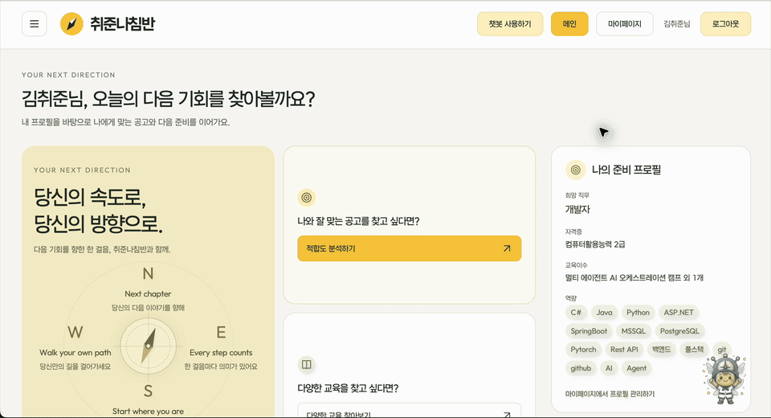
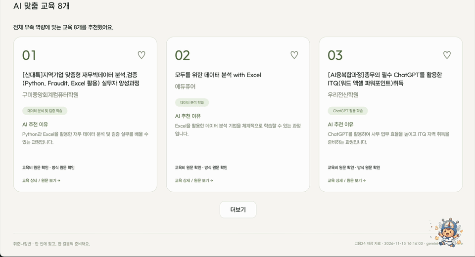
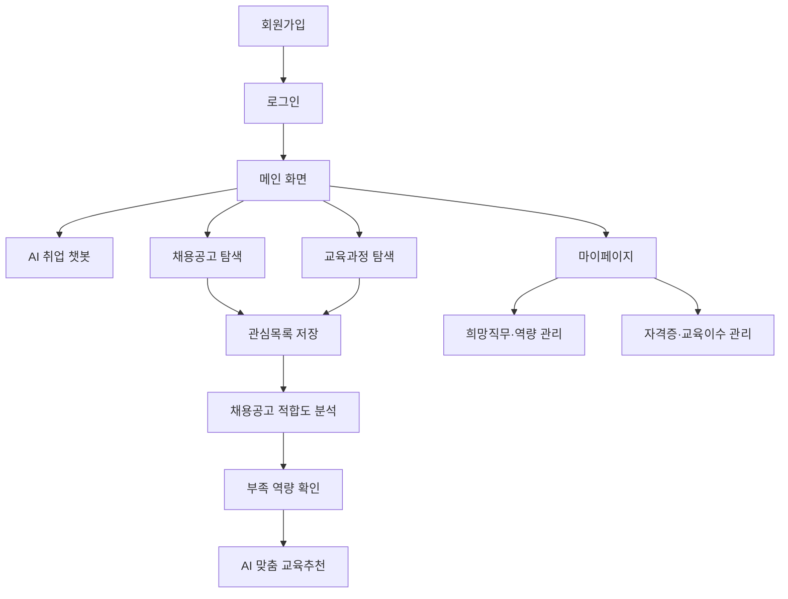

# 취준나침반 대시보드 구현 결과물

> 채용공고와 교육과정을 탐색하고, 관심 정보를 저장하며, 개인 프로필을 관리할 수 있는 취업 준비 지원 서비스

## 1. 프로젝트 소개

취준나침반은 취업 준비생이 채용공고와 교육과정을 한곳에서 조회하고, 자신의 희망 직무와 역량을 정리하면서 다음 준비 방향을 찾을 수 있도록 만든 웹 서비스입니다.

사용자는 회원가입과 로그인을 거친 뒤 다음 기능을 이용할 수 있습니다.

- 채용공고 검색 및 상세 조회
- 교육과정 조회 및 상세 확인
- 채용공고·교육과정 관심목록 저장
- 희망직무, 역량, 자격증, 교육이수 정보 관리
- 채용공고 적합도 분석
- 교육과정 추천
- 로그인 사용자를 위한 마이페이지 대시보드

## 2. 주요 기능

### 1) AI 취업 챗봇

취업 준비 고민을 입력하면 나침이가 공고 검색, 적합도 분석, 교육추천 등 다음 행동을 안내합니다.

### 2) 채용공고 적합도 분석

저장한 채용공고와 사용자 프로필의 역량을 비교해 적합도 점수, 일치 역량, 부족 역량을 제공합니다.

### 3) AI 맞춤 교육추천

적합도 분석에서 확인된 부족 역량과 사용자 직무를 기준으로 필요한 교육과정을 추천합니다.

## 3. 주요 기능 GIF 후보

화면 전체 구성은 [화면 설계서](2.화면%20설계서)를 확인하고, 아래 GIF는 핵심 기능의 동작 흐름을 빠르게 보여주는 용도로 사용합니다.

<table>
  <tr>
    <th>03. 메인 - 챗봇</th>
    <th>06. 적합도 분석</th>
    <th>07. 교육추천</th>
  </tr>
  <tr>
    <td></td>
    <td></td>
    <td></td>
  </tr>
  <tr>
    <td>취업 고민을 입력하면 나침이가 서비스 이용 방법과 다음 행동을 안내합니다.</td>
    <td>저장한 채용공고와 프로필 역량을 비교해 적합도 점수와 부족 역량을 보여줍니다.</td>
    <td>부족 역량과 희망직무를 바탕으로 맞춤 교육과정을 추천합니다.</td>
  </tr>
</table>

## 4. 서비스 이용 흐름



## 5. 화면 기획 항목별 구현 결과

| 화면 | 구현 내용 |
|---|---|
| 01. 회원가입 | 이메일·비밀번호 입력, 이메일 인증, 입력값 검증 및 가입 완료 후 로그인 이동 |
| 02. 로그인 | 로그인·세션 인증, 오류 메시지, 보호 화면 접근 제어 |
| 03. 메인-챗봇 | 희망직무 기반 공고 노출, 주요 메뉴 이동, 나침이 챗봇 상담 |
| 04. 공고모음 | 채용공고 검색·상세 조회, 관심목록 저장, 적합도 분석 연결 |
| 05. 교육모음 | 교육과정 조회, 교육 정보 확인, 관심 교육 저장 |
| 06. 적합도 분석 | 채용공고와 프로필 역량 비교, 점수·일치 역량·부족 역량 제공 |
| 07. 교육추천 | 희망직무와 부족 역량 기반 맞춤 교육과정 추천 |
| 08. 마이페이지 | 기본 정보, 희망직무·역량, 자격증·교육이수, 관심목록 관리 |

전체 화면 구성과 UI/UX 상세 내용은 [화면 설계서](2.화면%20설계서)를 참고합니다.

## 6. 시스템 구성

```text
사용자 브라우저
      │
      ▼
FastAPI 애플리케이션
      ├─ auth          회원가입·로그인·세션 인증
      ├─ main          메인 화면
      ├─ mypage        프로필·관심목록·대시보드
      ├─ job_posts     채용공고 조회
      ├─ training_posts 교육과정 조회
      ├─ jd_match      채용공고 적합도 분석
      └─ training_match 교육과정 추천
      │
      ├─ PostgreSQL / Supabase Auth
      └─ 외부 API 및 데이터 수집 모듈
```

### 기술 스택

| 구분 | 기술 |
|---|---|
| Backend | Python, FastAPI, Uvicorn |
| Database | PostgreSQL, psycopg |
| Authentication | Supabase Auth, 세션 쿠키 |
| Web UI | HTML, CSS, JavaScript, FastAPI HTMLResponse |
| External API | 고용24 API 등 외부 데이터 연동 |
| Validation | FastAPI 요청 검증 및 프론트엔드 입력 검증 |

## 7. 주요 API 및 라우팅

### 인증

- `GET /signin` : 로그인 화면
- `GET /signup` : 회원가입 화면
- 회원가입·로그인·로그아웃 및 세션 검증

### 마이페이지

- `GET /mypage` : 마이페이지 대시보드
- `GET /mypage/profile` : 개인정보 수정 화면
- `GET /api/mypage/profile` : 희망직무·자격증·교육이수 정보 조회
- `PUT /api/mypage/profile` : 희망직무 수정
- `GET/PUT /api/mypage/skills` : 역량 조회·수정
- `GET/POST/PATCH/DELETE /api/mypage/certifications` : 자격증 관리
- `GET/POST/PATCH/DELETE /api/mypage/trainings` : 교육이수 관리
- 관심목록 조회·저장·삭제 API

모든 마이페이지 데이터는 로그인한 사용자 기준으로 처리하며, 인증되지 않은 요청은 로그인 화면으로 이동합니다.

## 8. 통합 문서 허브

| 문서 | 내용 |
|---|---|
| [최종기획안](0.최종기획안.md) | 서비스 목표, 사용자 문제, 핵심 기능 및 기획 방향 |
| [API 설계 문서](1.API%20설계%20문서.md) | 기능별 API, 요청·응답 구조, 인증 및 데이터 흐름 |
| [화면 설계서](2.화면%20설계서) | 회원가입, 로그인, 메인, 챗봇, 공고, 교육, 적합도 분석, 교육추천, 마이페이지 화면 기획 |
| [데이터베이스 설계서](3.데이터베이스%20설계서) | 테이블 구조, ERD, 컬럼 및 관계 설계 |
| [대시보드 구현결과물](4.대시보드%20구현결과물.md) | 현재 구현된 기능, GIF, 실행 방법 및 프로젝트 구조 |
| [인증 README](../modules/auth/README.md) | 회원가입, 로그인, 세션 및 인증 관련 안내 |
| [채용공고 README](../modules/job_posts/README.md) | 채용공고 조회 및 검색 기능 안내 |
| [교육과정 README](../modules/training_posts/readme.md) | 교육과정 조회 및 데이터 처리 안내 |
| [적합도 분석 README](../modules/jd_match/Readme.md) | 채용공고와 사용자 역량 비교 기능 안내 |
| [교육추천 README](../modules/training_match/readme.md) | 교육추천 기능 안내 |

화면 전체를 확인할 때는 화면 설계서를 기준으로 보고, 실제 구현 동작은 이 문서의 GIF와 관련 모듈 README를 함께 확인합니다.

## 9. 프로젝트 구조

```text
.
├── app.py                              # FastAPI 앱 및 라우터 등록
├── requirements.txt                    # Python 의존성
├── modules/
│   ├── auth/                           # 회원가입·로그인·회원 정보
│   ├── main/                           # 메인 화면
│   ├── mypage/                         # 대시보드·프로필·관심목록
│   │   ├── Mypage.py                   # 마이페이지 화면 라우터
│   │   ├── dashboard_ui.py             # 대시보드 HTML·CSS·JS
│   │   ├── profile_api.py              # 프로필·자격증·교육이수 API
│   │   └── bookmarks_api.py            # 관심목록 API
│   ├── job_posts/                      # 채용공고 검색·조회
│   ├── training_posts/                 # 교육과정 조회
│   ├── jd_match/                      # 채용공고 적합도 분석
│   └── training_match/                 # 교육과정 추천
├── shared/                             # DB·인증·공통 UI
└── docs/
    ├── 0.최종기획안.md
    ├── 1.API 설계 문서.md
    ├── 2.화면 설계서/
    ├── 3.데이터베이스 설계서/
    └── 4.대시보드 구현결과물.md
```

## 10. 실행 방법

### 환경 설정

`.env.example`을 참고하여 프로젝트 루트에 `.env` 파일을 작성합니다.

```env
DATABASE_URL=PostgreSQL_연결_문자열
SUPABASE_URL=Supabase_프로젝트_URL
SUPABASE_PUBLISHABLE_KEY=Supabase_공개_키
SUPABASE_EMAIL_REDIRECT_URL=이메일_인증_후_이동할_URL
WORK24_API_KEY=고용24_API_KEY
```

### 서버 실행

```bash
python -m pip install -r requirements.txt
uvicorn app:app --reload --env-file .env
```

실행 후 브라우저에서 `http://127.0.0.1:8000`에 접속합니다.

## 11. 구현 시 고려사항

- 개인정보와 관심목록 API는 로그인한 사용자 세션을 기준으로 동작합니다.
- 비밀번호는 화면에 노출하지 않고, 인증 정보는 환경변수로 관리합니다.
- 프로필 입력값은 서버·클라이언트 양쪽에서 검증합니다.
- 모바일 화면에서는 사이드바를 상단 메뉴 형태로 변경하여 주요 기능에 접근할 수 있도록 했습니다.
- 외부 API와 데이터베이스 연결이 필요한 기능은 환경변수가 설정된 실행 환경에서 확인해야 합니다.

## 12. 향후 보완 가능 사항

현재 구현 범위 외에 다음 항목을 추가로 개선할 수 있습니다.

- 대시보드에 취업 준비 진행률과 활동 통계 추가
- 관심목록 기반 맞춤 추천 고도화
- 프로필 변경 이력 및 데이터 내보내기
- 테스트 자동화 및 배포 환경별 운영 문서 보강

---

문서 기준일: 2026-11-13
