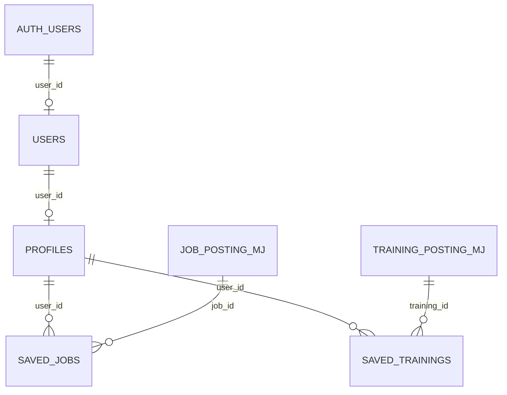

# database — 데이터 수집·저장 및 사용자 테이블 관리

`modules/database/`는 채용공고·교육과정 데이터를 수집해 Supabase에 저장하고, 사용자·프로필·북마크 테이블을 준비하는 코드입니다. 모든 실행 명령의 기준 위치는 **프로젝트 루트 `AIO_project1`**입니다.

## 폴더 구성

```text
modules/database/
├── README.md
├── table.py
├── job_posting/
│   ├── Readme.md
│   ├── model.py
│   ├── service.py
│   ├── source.txt
│   ├── save_to_supabase.py
│   ├── job_posting_mj.sql
│   ├── test_wanted_crawler.py
│   └── results/
└── training_posting/
    ├── README.md
    ├── service.py
    ├── collect.py
    ├── save_to_supabase.py
    ├── training_posting_mj.sql
    ├── test_work24_api.py
    ├── test_collection.py
    └── results/
```

| 구성 | 간략한 역할 | 자세한 설명 |
|---|---|---|
| [table.py](table.py) | 사용자·프로필·채용 북마크·교육 북마크 테이블 생성, Auth 사용자 정보 반영, 접근 권한 설정 | 아래 설명 참고 |
| [job_posting/](job_posting/) | 원티드 공고 HTML을 수집·변환하고 `public.job_posting_mj`에 저장 | [job_posting/Readme.md](job_posting/Readme.md) |
| [training_posting/](training_posting/) | 고용24 API로 직무별 교육을 수집·선정하고 `public.training_posting_mj`에 저장 | [training_posting/README.md](training_posting/README.md) |

각 수집 폴더의 파일 역할, 수집 기준, 실행법, 결과 파일 설명은 **해당 폴더 하위 리드미**를 확인하세요.

### 파일 이동에 따른 현재 참조 상태

채용 수집 코드는 `modules/job_posts/`에서 `modules/database/job_posting/`로, 교육 수집 코드는 `modules/training_posts/`에서 `modules/database/training_posting/`로 이동했습니다.

일부 수집·저장 코드와 테스트는 아직 이전 Python 모듈 경로를 참조합니다. 또한 이동된 파일의 `.env` 탐색은 프로젝트 루트에 맞춰 다시 계산해야 합니다. **하위 리드미의 실행 명령은 새 위치 기준이며, 각 문서의 ‘이동 후 실행 경로’ 점검 사항을 먼저 반영해야 합니다.** 이번 문서 변경에서는 Python 코드를 수정하지 않았습니다.

교육 공통 모델은 현재 [modules/training_posts/model.py](../training_posts/model.py)에 남아 있습니다. 수집 폴더 내부에 `model.py`가 있다고 가정하면 안 됩니다. 웹 화면·라우터용 코드는 기존 기능 폴더에 남아 있으며 DB 수집 코드와 구분합니다.

## table.py의 기능

`table.py`는 아래 **4개 테이블**을 준비합니다. 공고·교육 데이터 테이블을 새로 만드는 코드는 각 수집 폴더의 SQL 및 저장 코드입니다.

| 테이블 | 저장 내용 | 주요 관계·제약 |
|---|---|---|
| `public.users` | 사용자 이름·이메일·사용 여부 | `user_id`가 PK이자 `auth.users.id`를 참조하는 FK |
| `public.profiles` | 자격증·교육 이력·희망 직무·보유 역량·사용 여부 | `user_id`가 PK이자 `public.users.user_id`를 참조하는 FK. 사용자당 최대 한 행 |
| `public.saved_jobs` | 사용자가 저장한 채용공고와 저장 시각·북마크 여부 | `(user_id, job_id)` 복합 PK. 프로필과 채용공고를 연결 |
| `public.saved_trainings` | 사용자가 저장한 교육과정과 저장 시각·북마크 여부 | `(user_id, training_id)` 복합 PK. 프로필과 교육과정을 연결 |

### 컬럼

| 테이블 | 컬럼 |
|---|---|
| `users` | `user_id`, `name`, `email`, `use_yn` |
| `profiles` | `user_id`, `certification_name`, `certification_issuer`, `certification_acquired_date`, `training_name`, `training_provider`, `training_completed_date`, `desired_job`, `skills`, `use_yn` |
| `saved_jobs` | `user_id`, `job_id`, `created_at`, `use_yn` |
| `saved_trainings` | `user_id`, `training_id`, `created_at`, `use_yn` |

`skills`는 PostgreSQL **`text[]`** 타입입니다. 여러 역량을 `['Python', 'SQL', 'Excel']` 같은 문자열 목록으로 담을 수 있습니다. 기본값은 빈 배열이고, 현재 정의에서는 `NULL`도 허용합니다. 나머지 자격증·교육 이름 필드는 사진의 구조대로 단일 `text`입니다.

모든 `use_yn`은 `char(1) NOT NULL DEFAULT 'Y'`이며 `Y`와 `N`만 허용합니다. 북마크 `created_at`은 `timestamptz DEFAULT now()`입니다.

### 테이블 관계



기본 외래키 대상은 다음과 같습니다.

- `users.user_id` → `auth.users.id`
- `profiles.user_id` → `public.users.user_id`
- `saved_jobs.user_id`, `saved_trainings.user_id` → `public.profiles.user_id`
- `saved_jobs.job_id` → `public.job_posting_mj.id`
- `saved_trainings.training_id` → `public.training_posting_mj.id`

모든 외래키에 `ON DELETE CASCADE`를 적용합니다. Auth 사용자를 실제 삭제하면 연결된 사용자·프로필·북마크도 삭제되고, 공고·교육을 삭제하면 해당 북마크가 삭제됩니다. `use_yn` 값만 바꾸는 것은 실제 행 삭제가 아니므로 삭제 연쇄가 실행되지 않습니다.

`saved_trainings.training_id`는 교육 테이블의 **내부 UUID인 `id`**를 참조합니다. 고용24의 문자열 과정 ID를 담는 `training_posting_mj.training_id`와는 다른 값입니다.

## Auth 사용자 정보 반영

`table.py`를 실행하면 다음 순서로 처리합니다.

1. 북마크가 참조할 채용공고·교육 테이블이 존재하는지 확인합니다.
2. 4개 테이블을 `CREATE TABLE IF NOT EXISTS`로 준비합니다.
3. 컬럼·타입과 외래키 대상·삭제 연쇄 설정이 예상과 일치하는지 확인합니다. 불일치하면 자동 수정하지 않고 롤백합니다.
4. 실행 시점의 `auth.users`를 읽어 `public.users`에 추가하거나 같은 사용자 ID의 이름·이메일을 갱신합니다. 기존 `use_yn`은 보존합니다.
5. `public.users`에 대응하는 기본 프로필이 없으면 `user_id`만 지정해 생성합니다. 기존 프로필의 입력 정보는 덮어쓰지 않습니다.
6. RLS와 접근 권한을 설정하고 사용자 정보 반영 여부를 검증합니다. 모든 처리가 성공해야 커밋합니다.

이름은 `raw_user_meta_data`의 `name` → `full_name` → `display_name` 순으로 확인합니다. 모두 없으면 빈 문자열을 사용합니다. 이메일이 `NULL` 또는 빈 문자열이면 `users.email NOT NULL` 조건에 맞출 수 없어 해당 Auth 사용자는 동기화에서 제외하고 건수를 출력합니다.

동기화는 **명령 실행 시점 기준**입니다. 신규 가입이나 Auth 정보 변경 후 다시 실행해 반영할 수 있습니다. 자동 동기화 트리거는 이 코드에 정의되어 있지 않습니다. 새 프로필에는 자격증·교육·희망 직무 입력값을 임의로 채우지 않으며 `skills`는 기본 빈 배열을 사용합니다.

## 접근 권한

- 네 테이블에 RLS를 활성화합니다.
- `authenticated` 사용자는 `auth.uid() = user_id`인 자신의 행을 조회할 수 있습니다.
- `users`는 자신의 `name`, `use_yn`만 수정할 수 있습니다. 이메일은 Auth 정보 반영으로 관리합니다.
- `profiles`, `saved_jobs`, `saved_trainings`는 자신의 행을 추가·수정·삭제할 수 있습니다.
- `anon` 및 `PUBLIC`의 테이블 권한을 회수하고 `service_role`에는 전체 테이블 권한을 부여합니다.

## 실행 방법

먼저 프로젝트 루트에서 의존성과 `.env`를 준비합니다.

```bash
python -m pip install -r requirements.txt
```

`table.py`에 필요한 환경변수는 프로젝트 루트 `.env`의 `DATABASE_URL`입니다. 실제 연결 문자열과 비밀번호는 문서나 Git에 기록하지 않습니다.

북마크 연결 대상인 공고·교육 테이블이 이미 준비된 상태에서 실행합니다.

```bash
python -m modules.database.table
```

DB에 접속하지 않고 생성·동기화·권한 설정 SQL만 확인하려면:

```bash
python -m modules.database.table --print-sql
```

정식 공고 테이블을 별도로 준비해 둔 경우 이름을 지정할 수 있습니다.

```bash
python -m modules.database.table \
  --job-table job_postings \
  --training-table training_postings
```

위 옵션은 외래키를 연결할 **기존 테이블 이름을 지정**하는 것입니다. 테이블을 새로 만들거나 이름을 바꾸는 옵션이 아닙니다. 이미 만들어진 북마크 테이블의 외래키 대상과 다르면 검증에서 중단되므로, 기존 외래키 변경은 별도 마이그레이션으로 처리해야 합니다.

실행 결과에는 테이블별 행 수, Auth 사용자 수, 이메일 누락으로 제외한 수, 이름 메타데이터 누락 수, 연결된 공고·교육 테이블이 JSON으로 출력됩니다. 이름·이메일 같은 사용자 개인정보는 출력하지 않습니다.

수집 및 데이터 저장에 관한 자세한 명령은 [채용공고 리드미](job_posting/Readme.md)와 [교육과정 리드미](training_posting/README.md)를 확인하세요.
