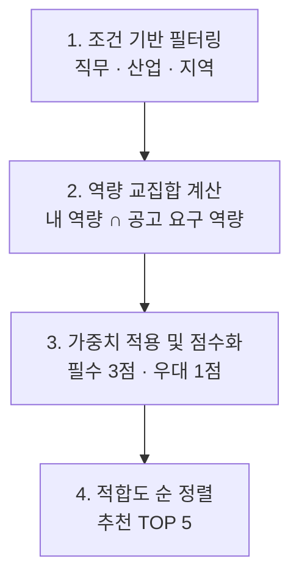

# 공고 추천 구현 방안

## 핵심로직: 공고 추천, 교육 추천 통합

```
my_skills = {"Python", "SQL", "Excel"}
job_skills = {"Python", "SQL", "AWS"}

# 1. 공고 추천: 충족 역량
matched = my_skills & job_skills

# 2. 교육 추천: 부족 역량
missing = job_skills - my_skills

# 3. 공고 적합도 (간단한 점수)
score = len(matched) / len(job_skills) * 100

print("충족 역량:", matched)
print("부족 역량:", missing)
print("적합도:", round(score, 1))
```

## B. 공고 추천 알고리즘


### 적합도 계산식

$$
\text{적합도(\%)}
=
\frac{
3 \times \text{충족한 필수역량 수}
+
1 \times \text{충족한 우대역량 수}
}{
3 \times \text{전체 필수역량 수}
+
1 \times \text{전체 우대역량 수}
}
\times 100
$$